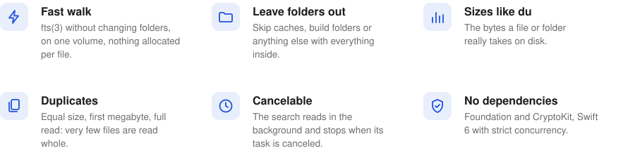
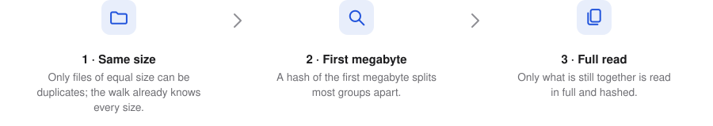

<p align="center">
  
</p>

Two building blocks every Mac tool that looks into folders needs: a fast walk over a file tree with fts(3), and a search
for files that exist more than once, which reads as few files as possible.

## What it does

<picture>
  <source media="(prefers-color-scheme: dark)" srcset="assets/pictures/features-dark.svg">
  
</picture>

## Install

Swift 6, macOS 13 or iOS 16. In `Package.swift`, then add the product `FileTreeKit` to your target:

```swift
dependencies: [.package(url: "https://github.com/Robertwlt03/file-tree-kit", from: "0.1.0")]
```

## Use

Walk a folder; returning `false` stops the walk:

```swift
import FileTreeKit

var largest: (path: String, bytes: Int64) = ("", 0)
FileTreeWalker.walk("/Users/me", excluding: ["/Users/me/Library/Caches"]) { entry in
    if FileTreeWalker.kind(of: entry) == FTS_F, let status = entry.pointee.fts_statp?.pointee {
        let bytes = FileTreeWalker.allocatedBytes(status)
        if bytes > largest.bytes { largest = (FileTreeWalker.path(of: entry), bytes) }
    }
    return true
}
```

The walk is physical (links are not followed), never changes the current folder and stays on the volume it starts on.
Each entry is fts's own, so walking millions of files allocates nothing per file. `walk` returns `false` when it was
stopped, when the start cannot be read, or when an error ended it early.

```swift
let onDisk = FileTreeWalker.allocatedBytes(of: "/Users/me/Movies")
```

## Duplicates

<picture>
  <source media="(prefers-color-scheme: dark)" srcset="assets/pictures/flow-dark.svg">
  
</picture>

```swift
let groups = await DuplicateFinder.duplicates(in: "/Users/me/Downloads")
let freeable = DuplicateFinder.spareBytes(groups)  // keep one of each, remove the rest
```

Files under 10 MB are left out by default (`smallestBytes:`), since they hardly free space and would mean reading many
more files. Have your own file list, such as a scanned tree? Make its type `SizedFile` (a `path` and `bytes`) and use
`sameSizeGroups`, then `confirmed`; `without(_:in:)` updates the groups once a file is gone.

Hard links to one file count once. APFS clones share their blocks too, so removing one frees nothing; macOS offers no
way to tell a clone from a copy by its path, so the search counts both.

## Contribute

Issues and pull requests are welcome. The tests build small trees in a temporary folder:

```bash
swift test
```

## License

[MIT](LICENSE)
